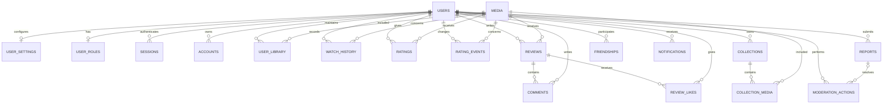

# Предварительная модель данных

Статус: в локальном PostgreSQL 18 применены миграции 0000–0006, реализованы 22 таблицы. Авторизация, каталог и социальные операции проверяются интеграционными тестами в отдельных схемах. Источник фактических имён и ограничений — `src/server/db/schema.ts` и SQL в `drizzle/`.
Даты — timestamptz; исключение — last_request ограничителя запросов (epoch milliseconds в bigint по требованиям Better Auth). Auth-идентификаторы — UUID, представленные text для совместимости с auth-адаптером. Идентификаторы предметных таблиц планируются как UUID, кроме внешних ID TMDB.

При advanced.database.generateId: uuid auth-адаптер ожидает генерацию ID базой. Поэтому users, sessions, accounts, verifications и rate_limits имеют SQL DEFAULT gen_random_uuid()::text; для существующей локальной БД это добавлено миграциями 0001 и 0002 без изменения существующих ID.

Миграция 0003 добавила media и catalog_cache; 0004 — библиотеку и социальные таблицы, блокировку, язык и уведомления; 0005 — исправления названия/классификации каталога; 0006 — персональную галочку. В media сохраняются идентичность, названия, постер и ID жанров. Подробности и титры находятся в JSON-кэше с языковым ключом. Media_translations, genres, genre_translations, media_genres, people и media_people в этой версии не создаются. Таблица activity также не создаётся: лента вычисляется из текущих доступных записей. Ниже — исходная целевая модель с этими будущими сущностями.

Фактические связи первой версии:

Служебные verifications, rate_limits и catalog_cache не имеют обязательной связи с пользователем. В user_roles PK=user_id и одна текущая роль user/admin. В users personal_badge=false по умолчанию, доступен только для доверенного назначения; он независим от роли. Цель жалобы проверяется сервером: ровно один доступный user/review/comment; после удаления цели FK допускает NULL. Уникальные позиции коллекций меняются под блокировкой её строки. Для комментария составной FK гарантирует родителя из той же рецензии.

## Целевая модель для развития

```mermaid
erDiagram
    USERS ||--|| USER_SETTINGS : configures
    USERS ||--o{ SESSIONS : authenticates
    USERS ||--o{ ACCOUNTS : owns
    USERS ||--o{ USER_ROLES : has
    USERS ||--o{ USER_LIBRARY : maintains
    MEDIA ||--o{ USER_LIBRARY : included
    USERS ||--o{ WATCH_HISTORY : records
    MEDIA ||--o{ WATCH_HISTORY : concerns
    USERS ||--o{ RATINGS : gives
    MEDIA ||--o{ RATINGS : receives
    USERS ||--o{ RATING_EVENTS : changes
    MEDIA ||--o{ RATING_EVENTS : concerns
    MEDIA ||--o{ MEDIA_TRANSLATIONS : translated
    MEDIA ||--o{ MEDIA_GENRES : classified
    GENRES ||--o{ MEDIA_GENRES : assigned
    MEDIA ||--o{ MEDIA_PEOPLE : credits
    PEOPLE ||--o{ MEDIA_PEOPLE : participates
    USERS ||--o{ REVIEWS : writes
    MEDIA ||--o{ REVIEWS : receives
    REVIEWS ||--o{ COMMENTS : contains
    USERS ||--o{ COMMENTS : writes
    REVIEWS ||--o{ REVIEW_LIKES : receives
    USERS ||--o{ REVIEW_LIKES : gives
    USERS ||--o{ COLLECTIONS : owns
    COLLECTIONS ||--o{ COLLECTION_MEDIA : contains
    MEDIA ||--o{ COLLECTION_MEDIA : included
    USERS ||--o{ FRIENDSHIPS : participates
    USERS ||--o{ ACTIVITY : produces
    USERS ||--o{ NOTIFICATIONS : receives
    USERS ||--o{ REPORTS : submits
    USERS ||--o{ MODERATION_ACTIONS : performs
```

## Таблицы и ограничения

| Таблицы | Содержание и ограничения |
|---|---|
| users, sessions, accounts, verifications | Auth-схема Better Auth; уникальные нормализованные email и username; публичное имя и био отдельно от приватных полей |
| user_settings | PK/FK user_id; язык, тема, отдельная приватность профиля/библиотеки/активности, предпочтения уведомлений |
| user_roles | UNIQUE(user_id, role); запись только доверенной серверной операцией |
| media | UNIQUE(tmdb_media_type, tmdb_id); CHECK типа movie/tv; оригинальное название, даты, пути изображений и время обновления |
| media_translations | UNIQUE(media_id, language); переведённые название/описание и время обновления |
| genres, media_genres | Уникальный внешний ID жанра; составной PK(media_id, genre_id); переводы жанров в отдельной таблице genre_translations |
| people, media_people | Уникальный tmdb_id человека; связь с произведением, credit_id, должность, персонаж и порядок; несколько ролей одного человека допустимы |
| user_library | UNIQUE(user_id, media_id); nullable status, is_favorite; CHECK допустимых статусов |
| watch_history | user_id, media_id, watched_on (дата пользователя), заметка, created_at; повторные просмотры допустимы |
| ratings | UNIQUE(user_id, media_id); score_units smallint CHECK 2..20; created_at/updated_at |
| rating_events | user_id, media_id, старое/новое nullable значение, created_at; создание, изменение и удаление текущей оценки записываются в одной транзакции с ratings |
| reviews | UNIQUE(user_id, media_id); текст, visibility, contains_spoilers, состояние модерации и даты |
| comments | author_id, review_id, nullable parent_id; ответ допускается только на комментарий той же рецензии; серверная и БД-проверка |
| review_likes | Составной PK(user_id, review_id) |
| collections | owner_id, название, описание, visibility public/private, даты |
| collection_media | PK(collection_id, media_id); position; UNIQUE(collection_id, position), перестановка в транзакции |
| friendships | user_low_id, user_high_id, requested_by, status; UNIQUE пары; CHECK low < high, инициатор входит в пару; оба участника — FK users |
| activity | actor_id, тип и конкретные FK на rating/review/collection/watch_history; CHECK совместимости типа и цели; без копий закрытого текста |
| notifications | recipient_id, actor_id, тип, read_at и конкретные FK на источник события; дедупликация по ключу события и получателю |
| reports | reporter_id, reason, status; ровно одна цель из user/review/comment через конкретные FK |
| moderation_actions | moderator_id, действие, причина, дата, ссылка на жалобу; ограниченный доступ |
| catalog_cache | UNIQUE(provider, request_key, language); ответ поиска, expires_at; ограниченный размер и очистка устаревшего |

Незаписанные в диаграмме служебные таблицы: verifications, genre_translations и catalog_cache. Auth-библиотека может потребовать дополнительные поля и ограничения.

## Чтение и целостность

- Индексы: библиотека (user_id, status, updated_at), просмотры (user_id, watched_on), рецензии (media_id, created_at), комментарии (review_id, created_at), уведомления (recipient_id, created_at), активность (actor_id, created_at), обе стороны friendships.
- Списки используют пагинацию с устойчивой парой даты и ID; поиск по каталогу использует отдельные индексы после выбора точных запросов.
- Ratings содержит только текущие голоса. История оценок не участвует в агрегировании.
- Изменение записи, история и событие активности создаются одной транзакцией. Сетевые запросы и отправка почты не выполняются внутри долгой транзакции БД.
- Профиль всегда доступен при принятой дружбе; варианты friends/public, по умолчанию friends. Миграция 0007 переводит прежний private профиль в friends. Библиотека, активность и рецензии с private доступны только владельцу; профиль друга не раскрывает их. Блокировка аккаунта ограничивает доступ дополнительно.
- Для таблиц с несколькими целями нужны CHECK и конкретные FK, а не непроверяемая пара entity_type/entity_id.

## Удаление и миграции

- При удалении аккаунта удаляются сессии, настройки, роли, библиотека, история, оценки, рецензии, комментарии, лайки, коллекции, дружба и связанные события/уведомления. Общий каталог сохраняется.
- Удаление рецензии удаляет её комментарии, лайки и связанные события. Удаление коллекции — только её состав, а не произведения каталога.
- Для целей жалоб допустим SET NULL с сохранением минимальной служебной причины и типа цели; срок хранения жалоб и модерационных записей определяется до публичной регистрации. Не сохранять удалённый текст или email в журнале без необходимости.
- Аккаунт сначала блокируется для новых запросов, сессии отзываются; очистка данных выполняется согласованно. Политика удаления из резервных копий описывается отдельно до публикации.
- Миграции по частям: auth → каталог → библиотека/оценки → рецензии/коллекции/модерация → социальные функции.
- Проверки миграций: развёртывание на чистой БД, целостность FK/CHECK/UNIQUE, обновление существующей БД без потери данных и пробное восстановление резервной копии.
