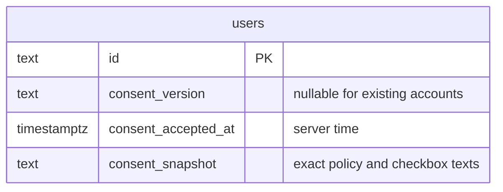

# Политика и подтверждения пользователей

Этап: короткая публичная политика, два явных подтверждения при регистрации (обработка и зарубежная передача), серверная проверка, отзыв через удаление своего аккаунта. Аудитория — учебное кино-сообщество друзей из Кыргызстана. Хостинг приложения и PostgreSQL — alwaysdata, Франция. Почта — прежний Gmail. Платные сервисы не добавляются.

Новые поля nullable, миграция не меняет существующие записи и не создаёт фиктивные согласия. Регистрация проверяет boolean true для двух полей и точную актуальную версию до записи аккаунта. Свидетельство подтверждения добавляется в ту же операцию вставки пользователя. Клиент не может назначить дату, текст или версию через дополнительные поля пользователя либо переписать запись через update-user. Подтверждение прежнего аккаунта записывается только от его сессии; повторный запрос не меняет время принятия. При будущей смене версии нельзя молча перезаписывать прошлую запись: потребуется отдельная история версий.

Отзыв обрабатывается только для пользователя текущей сессии после явного подтверждения удаления. Удаляются пользователь, связанные по FK данные и связанные записи верификации. Не удаляется общий каталог. Свидетельство согласия не хранится после удаления пользователя. Старые резервные копии автоматически не восстанавливать поверх рабочей БД; их уничтожение и сроки провайдера требуют отдельного контроля.

Проверки: регистрация без подтверждений/с ложным boolean/со старой версией запрещена без создания пользователя и отправки письма; сервер сам назначает доказательства; попытка изменить их через update-user запрещена; прежним аккаунтам миграция оставляет null; отзыв не принимает чужой userId. Политика доступна без входа, в том числе после закрытия месячного окна. При закрытом окне запрос об удалении можно отправить на указанный контакт.

Эта реализация не является юридическим заключением. Согласие не заменяет требования к безопасности, договорам обработчиков и дееспособности владельца. Консультация: см. локальный пакет в исключённой из Git папке docs/legal/.

Проверено 15 ноября 2026: lint, TypeScript, production build, 23 модульных теста, 5 интеграционных сценариев PostgreSQL и 5 браузерных сценариев Playwright. Браузерная проверка включает обе неотмеченные обязательные галочки, подтверждение прежнего тестового аккаунта и отзыв с проверкой удаления только этого аккаунта. Реальные аккаунты и почтовые ящики в этих сценариях не использовались.
